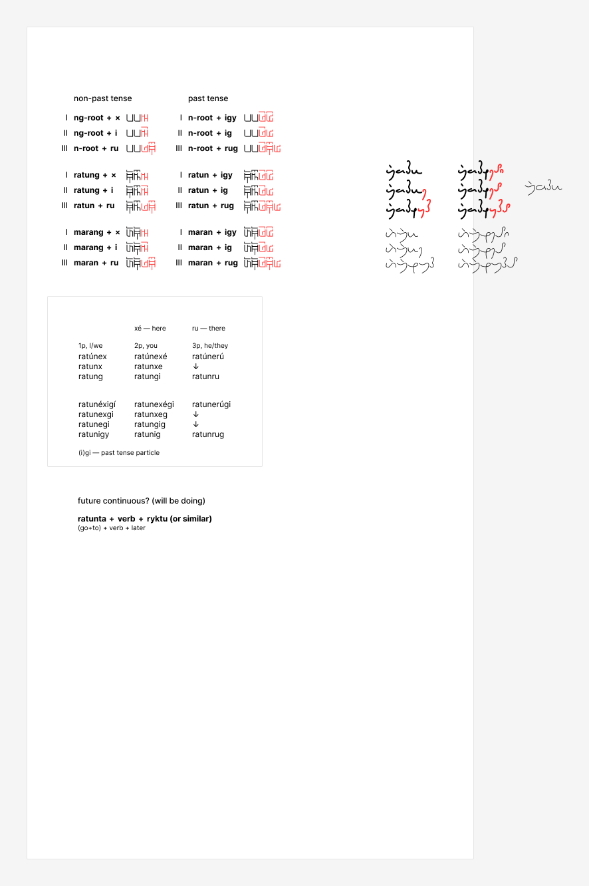

# Verbs

A Zabzy 1 verb has two stems: the **ng-stem** (*ratung*, the dictionary form) and the
**n-stem** (*ratun*). Endings mark person and tense.

## Conjugation

| | Non-past | | Past | |
|---|---|---|---|---|
| 1st person (I, we) | ng-stem | *ratung* | n-stem + *-igy* | *ratunigy* |
| 2nd person (you) | ng-stem + *-i* | *ratungi* | n-stem + *-ig* | *ratunig* |
| 3rd person (he, they) | n-stem + *-ru* | *ratunru* | n-stem + *-rug* | *ratunrug* |

The same with [[marang]]: *marang · marangi · maranru*, past *maranigy · maranig · maranrug*.

## Where the endings come from

Person is marked by place words: the 2nd person ending goes back to [[ki]] (proto *xé*,
*here*), the 3rd to [[ru]] (*there*). The 1st person has no ending. The past adds the
particle *(i)gi*.

| | 1st person | 2nd person | 3rd person |
|---|---|---|---|
| proto, non-past | *ratúnex* | *ratúnexé* | *ratúnerú* |
| | *ratunx* | *ratunxe* | ↓ |
| Zabzy 1 | *ratung* | *ratungi* | *ratunru* |
| proto, past | *ratunéxigí* | *ratunexégi* | *ratunerúgi* |
| | *ratunexgi* | *ratunxeg* | ↓ |
| | *ratunegi* | *ratungig* | ↓ |
| Zabzy 1 | *ratunigy* | *ratunig* | *ratunrug* |

## Future

Not settled. The working idea is a periphrasis: *ratunta* *(go + to)* + verb + [[ryktu]]
*later*, as in *kuvun ratunta sabzynru ryktu ma daz* — *and will go on to guide them*.

## In the dialects

Zabzy 2 has lost person agreement on verbs. Spelled out in the sheet for one verb:
*xéfulánelúgi* → Zabzy 1 *kifuranrug*, Zabzy 2 *kejɸuɾajnɾüg*, Zabzy 3 *cexwùlanluj*.

