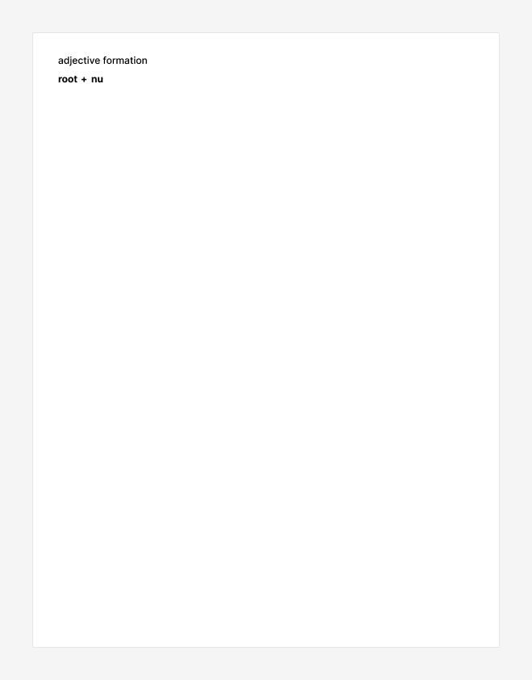

# Word formation

- **Verb → noun** with [[-so]]: [[ratung]] → [[ratuso]] *movement*, [[vundung]] → [[vunduso]] *music*.
- **Noun → adjective** with [[nu (adjective)]]: see [[Adjectives]].
- **Causative** with [[sa-]]: [[bzyng]] *to see* → [[sabzyng]] *to guide, to show*.
- **Compounds**: [[tysyn]] *smoke* + [[fy (water)]] → [[tysynfy]] *mist*;
  [[fy (not)]] + [[fy (water)]] → [[fyfy]] *desert*; [[daf]] + [[sav]] → [[dapsav]] *far places*;
  [[ki]] + [[furang]] → [[kifurang]] *to respect*.
- **Reduplication**: *mazmazang* *everyone*, from [[mzang (many)]].
- Unclear yet: [[ga-]] *before?*, [[ta-]] (abstract marker), [[-ta]].

