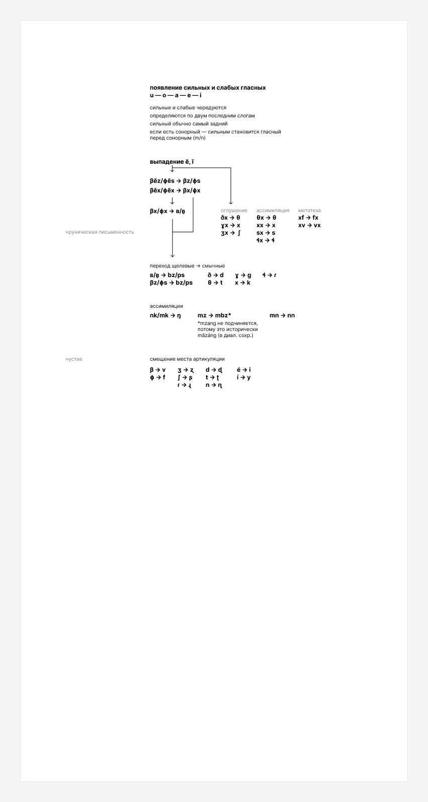
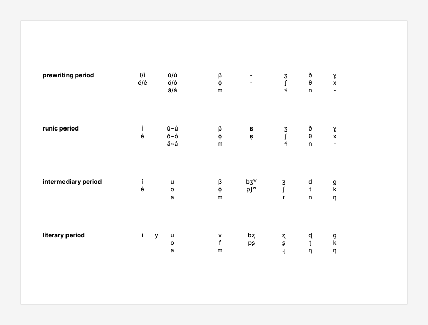

# Sound changes

From the proto-language to literary Zabzy 1, in order. Source: the Figma board, page
*clean data*, section *timeline*.

1. **Strong and weak vowels appear.** On the scale *u — o — a — e — i*, strong and weak
   vowels alternate, counted from the last two syllables. The strong one is usually the
   furthest back; if there is a sonorant (*m*, *n*), the vowel before it becomes strong.
2. **Loss of ĕ, ĭ.**
   - *βĕz/ɸĕs → βz/ɸs*, *βĕx/ɸĕx → βx/ɸx*, then *βx/ɸx → ʙ/ʙ̥*
   - devoicing: *ðx → θ*, *ɣx → x*, *ʒx → ʃ*
   - assimilation: *θx → θ*, *xx → x*, *sx → s*, *ɬx → ɬ*
   - metathesis: *xf → fx*, *xv → vx*

   ≈ the runic script appears.
3. **Fricatives become stops.** *ʙ/ʙ̥ → bz/ps*, *βz/ɸs → bz/ps*, *ð → d*, *θ → t*,
   *ɣ → g*, *x → k*, *ɬ → ɾ*.
4. **Assimilation.** *nk/mk → ŋ*, *mz → mbz*, *mn → nn*.
   [[mzang (many)]] escapes *mz → mbz* because it was historically *măzáng*, which the
   dialects keep.
5. **Shift of place.** *β → v*, *ɸ → f*; *ʒ → ʐ*, *ʃ → ʂ*, *ɾ → ɻ*; *d → ɖ*, *t → ʈ*,
   *n → ɳ*; *é → i*, *í → y*.

   ≈ the book hand (*ustav*) appears.

## Periods

The Zabzy 1 inventory at each stage.

| Period | Vowels | | Labials | | Sibilants | Dentals | Velars |
|---|---|---|---|---|---|---|---|
| prewriting | ĭ/í ĕ/é | ŭ/ú ŏ/ó ă/á | β ɸ m | — | ʒ ʃ ɬ | ð θ n | ɣ x |
| runic | í é | ŭ~ú ŏ~ó ă~á | β ɸ m | ʙ ʙ̥ | ʒ ʃ ɬ | ð θ n | ɣ x |
| intermediary | í é | u o a | β ɸ m | bʒʷ pʃʷ | ʒ ʃ ɾ | d t n | g k ŋ |
| literary | i y | u o a | v f m | bʐ pʂ | ʐ ʂ ɻ | ɖ ʈ ɳ | g k ŋ |

The periods match the stages in [[Inventory]] only roughly: *stage 1* is about the runic
period, *stage 2* the intermediary one.
