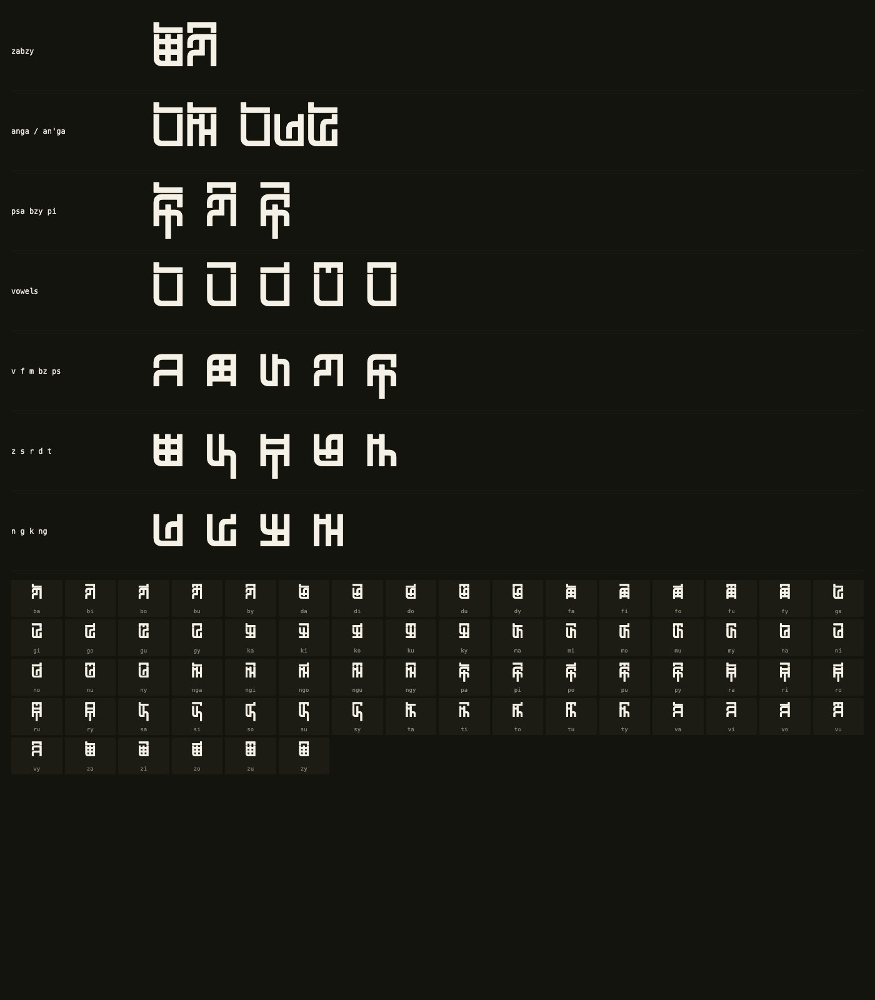

# Zabzy

A constructed language: one proto-language and the three dialects that grew out of it.
Every word exists in four forms — proto *zavisí* "person" → *zabzy* / *zabvía* / *źaźwi* —
and the main dialect has a written history of its own, from runes to a literary script.

Этот репозиторий одновременно является волтом Obsidian: открой его корень как волт.



## Structure

| Folder | What's inside |
| --- | --- |
| `Language/Lexicon/` | One note per word, named after its Zabzy 1 form, with the proto-form and both other dialects |
| `Language/Affixes/` | Prefixes and suffixes |
| `Language/Grammar/` | Verbs, adjectives, pronouns, numerals, particles, word formation |
| `Language/Phonology/` | Sound inventory of every stage, sound changes in order, transliteration |
| `Language/Dialects/` | What sets Zabzy 1, 2 and 3 apart |
| `Script/` | The printed syllabary and the handwriting |
| `Corpus/` | Texts: *The wise elder*, *The song of the birds*, *The desert* (in progress) |
| `Drafts/` | Not a source of truth |
| `Meta/` | Note templates and Obsidian Bases tables |
| `font/` | **Zabzy Bold**, the printed script as an installable font |
| `images/` | Boards from Figma |
| `tools/` | Checks and build; `tools/legacy/` holds the old YAML files and the proto → dialect script |
| `build/` | Written by the build script, not stored in git |

Start with [Verbs](Language/Grammar/Verbs.md) and [Sound changes](Language/Phonology/Sound%20changes.md).

## Working in the vault

- **Add a word**: create a note in `Language/Lexicon/` named after the Zabzy 1 form,
  then *Insert template* (Cmd+P) → `Lexeme`. Homonyms get a hint in brackets:
  `fy (water)`, `fy (not)`.
- **See the whole lexicon**: `Meta/Bases/Lexicon.base` — filter by part of speech, by
  missing Zabzy 2 forms, by words that need checking.
- **Before committing**:

  ```bash
  python3 tools/check.py && python3 tools/build.py
  ```

  `check.py` fails only on broken structure (missing field, link to nowhere, text not in
  NFC); gaps in the language are printed as a summary. `build.py` writes
  `build/lexicon.json`.

## Sources

Collected on 2 November 2026 from the Google Sheet *zabzy* (sheets *lexicon*, *stories*,
*phonetics*, *grammar*) and the Figma file *zabzy* (page *clean data*). The Figma page
*wip* was not used.

---

Made by [Azoy Sheyn](https://youtube.com/@azoysheyn).
