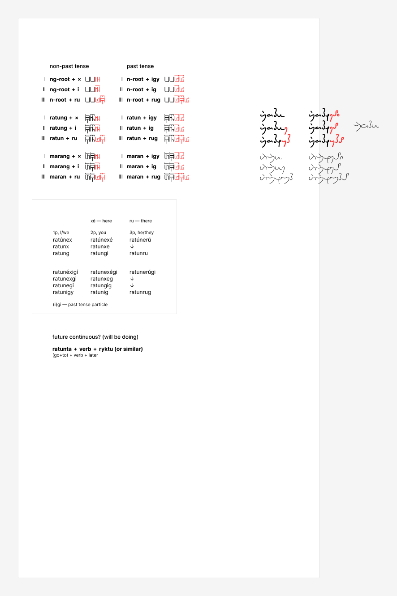

# Handwriting

The cursive of [[Zabzy 1]] — the *writing* column of the Figma lexicon and the
*Handwriting Letters* component. Installable as the font **Zabzy Hand**:
`font-hand/dist/`. Type Latin, get the handwriting.

In the conjugation tables the verb endings are marked in red, in both scripts.

[[Zabzy 2]] and [[Zabzy 3]] have scripts of their own too; they are not exported yet.
