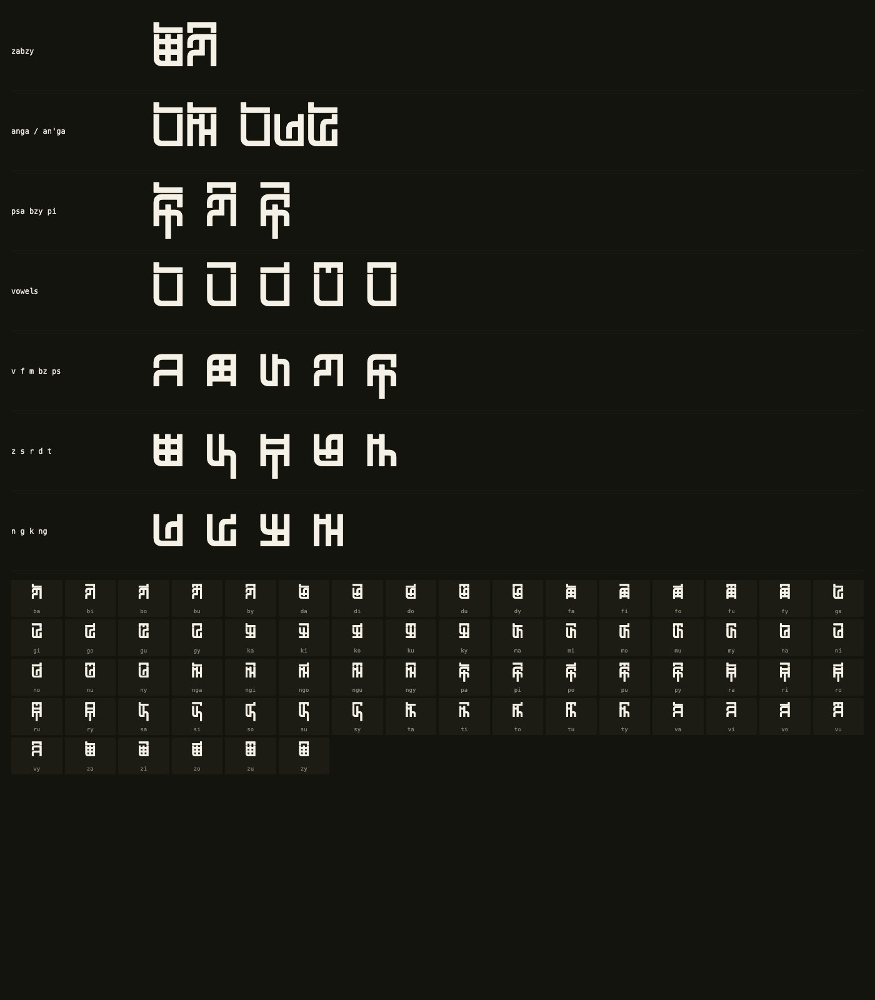
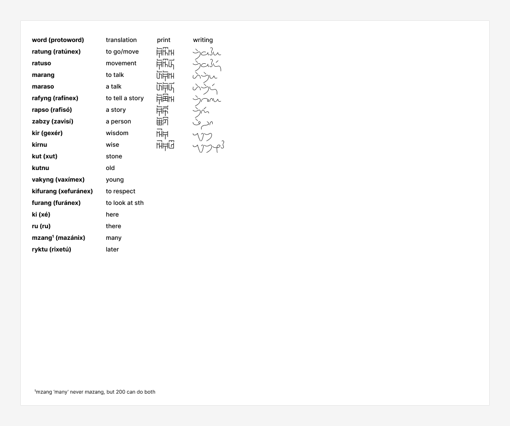

# Print

The printed script of [[Zabzy 1]]: a syllabary of square signs. A consonant sign carries
the vowel as a mark on top; a vowel alone sits on an empty base.

It exists as a font, **Zabzy Bold**, in [`font/`](../font/). Typing Latin gives Zabzy:
*za*, *bzy*, *nga* become one sign each; *n'g* keeps *n* and *g* apart. Full rules:
[`font/README.md`](../font/README.md).

In Figma this script is the *Letterpress letter* component, and the *print* column of
the lexicon.

